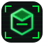
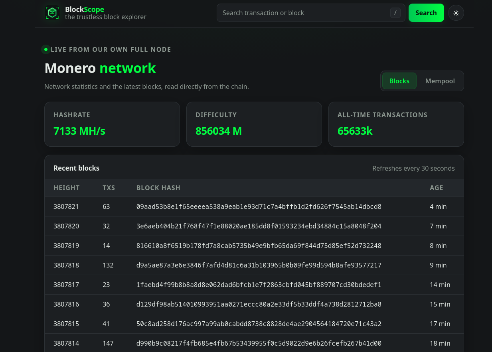
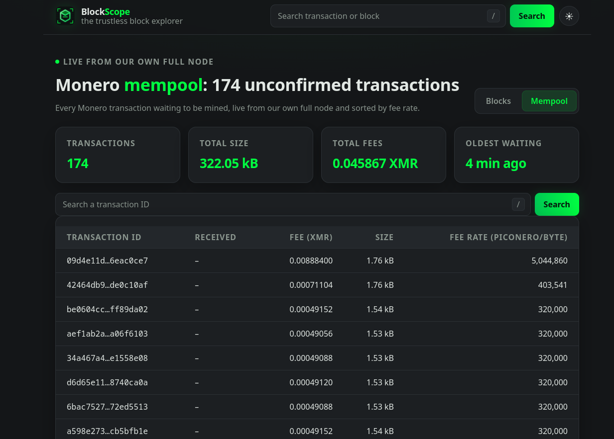

<h1 align="center">BlockScope</h1>

<p align="center">
  
</p>

<p align="center">
  <a href="https://github.com/smiley-mcsmiles/BlockScope/releases"></a>
  <a href="license.txt"></a>
  <a href="https://go.dev"></a>
  <a href="Dockerfile"></a>
  <a href="https://www.monero.org"></a>
</p>

<p align="center">
  
  
  
  
  
</p>

<p align="center">
  A trustless <b>block explorer</b> for the Monero network that reads everything from <b>your own node</b>,<br>
  with a dark, hacker-green interface, a live mempool, and tools to decode outputs and prove payments.
</p>

BlockScope reads everything directly from your own `monerod` node, so you don't have to trust a third-party explorer for the chain data.

## Screenshots

**Blocks**



**Mempool**



## Features

- **Network overview:** hashrate, difficulty, all-time transaction count and the most recent blocks, refreshed automatically.
- **Block pages:** block details, reward, size and every transaction in the block, with previous and next block navigation.
- **Transaction pages:** confirmation status, block height, timestamp, size and double-spend detection.
- **Mempool:** unconfirmed transactions sorted by fee rate, with totals and a live search by transaction ID.
- **Decode outputs:** check which outputs in a transaction belong to a Monero address or subaddress and viewkey, and decode their amounts for RingCT transactions.
- **Prove sending:** prove that a transaction paid a given address, using the transaction private key from `get_tx_key`.
- **Light and dark themes**, plus keyboard shortcuts (`/` focuses search).

## Requirements

- Go 1.18 or newer, to build from source.
- A running Monero daemon (`monerod`) that BlockScope can reach. It must be reachable when BlockScope starts.

## Building

```
git clone https://github.com/smiley-mcsmiles/BlockScope
cd BlockScope
go build ./
```

This produces a `blockscope` binary in the project directory.

## Docker

The included `Dockerfile` builds BlockScope from this repository and runs it on port `31312`:

```
docker build -t blockscope .
docker run -p 31312:31312 blockscope --daemon <node-host>:18081
```

Inside a container `127.0.0.1` refers to the container itself, so give `--daemon` the address of your node on the network.

## Running

Point BlockScope at your node with `--daemon`, then open the address given by `--bind` in your browser.

```
./blockscope --daemon 127.0.0.1:18081
```

Then open [http://127.0.0.1:31312](http://127.0.0.1:31312/).

### Flags

| Flag | Default | Description |
| --- | --- | --- |
| `--daemon` | `127.0.0.1:18081` | Address of the Monero daemon RPC. |
| `--bind` | `127.0.0.1:31312` | Address and port BlockScope listens on. |
| `--proxy` | `none` | Proxy for the daemon connection, such as `socks5://127.0.0.1:9050` for Tor. |
| `--rpc-login` | `none` | Credentials for a daemon with RPC login enabled, in the form `password:username`. |

### Remote and restricted nodes

To use a remote node, give its address to `--daemon`:

```
./blockscope --daemon <remote-node>:18081
```

To route the daemon connection through Tor:

```
./blockscope --proxy socks5://127.0.0.1:9050 --daemon <remote-node>:18081
```

The mempool page works best with the node's unrestricted RPC port (usually `18081`). Restricted RPC ports (usually `18089`) don't serve the full transaction pool, so BlockScope falls back to the calls they do allow. In that mode the mempool shows fees and sizes, but not when each transaction was received.

## Privacy

The decode outputs and prove sending tools send your Monero address and secret keys to the BlockScope server, which does the calculations. If you use a server you don't control, anyone running it can see those keys. Run BlockScope on your own machine or network when you use these tools.

## Development

```
go test ./
```

## Credits and license

BlockScope is derived from [MoneroBlock](https://github.com/duggavo/MoneroBlock) and is distributed under the BSD 3-Clause License. The original copyright notice is preserved in [license.txt](license.txt), and changes and additions are copyright WOOSAH. BlockScope is not endorsed by the original authors of MoneroBlock.
